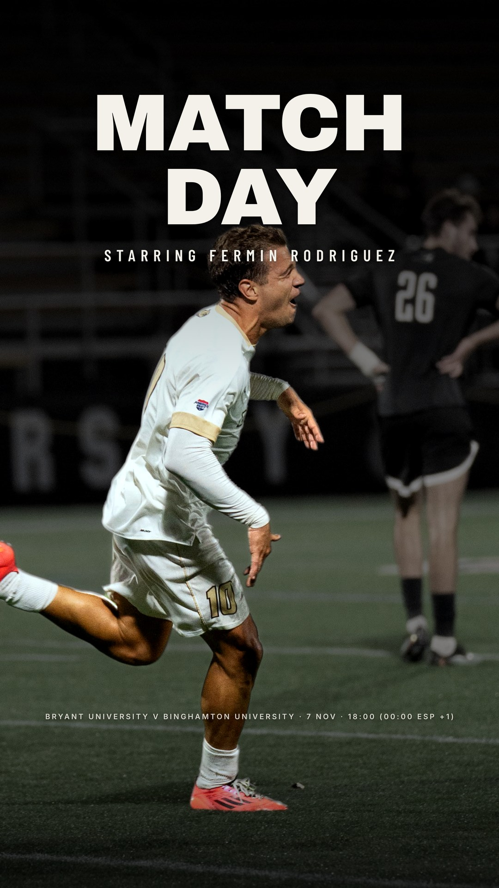

# GameDay Image Maker

**An internal tool that turns a football player's photo and fixture into a ready-to-post Instagram graphic, end to end. Built with AI, and with AI inside it.**

<p align="center">
  
  <br/>
  <sub>Example output: a matchday story, generated from one match photo and the fixture data (US college soccer, kick-off shown in the local and the player's home time zone).</sub>
</p>

It was built for a football player-management agency that posts matchday, goal and result graphics for each of its players every week. Before, a designer made each one by hand in Photoshop. Now the agency picks a photo, chooses one of the generated designs and exports a story-ready image in under a minute. I'm the only developer; the agency's staff are the daily users.

---

## What it does

| | |
|---|---|
| **Keeps every player's season up to date** | Pulls fixtures, results, line-ups and scorers from public sources. These are zerozero (the Portuguese football database) and Transfermarkt for European leagues, and US college athletics sites for NCAA players (Sidearm and WMT platforms plus their iCal feeds). Kick-off times are handled across time zones: a US game shows its local time and the Portuguese one. On match day it polls the live score and suggests a goal post the moment the player scores. |
| **Prepares the photo automatically** | Removes the background and works out *which* person in a crowded match photo is our player (face recognition against a reference headshot). It also upscales low-resolution photos and detects where the frame cuts the player. Once a day it can find new photos of each player in the news and confirm by face that it's really him. |
| **Generates designs** | 1,000+ graphic "looks" are written as React components. They render matchday, goal, result, player-of-the-match, transfer and stats posts in Instagram post (4:5) and story (9:16) formats, exported as PNG/JPG, a 3-second MP4 with motion, or a vector PDF. Every look follows the club's colours, uses exact club names and crests, and adds the agency logo. |
| **Learns what each player likes** | Every export is recorded. The suggestion grid mixes looks the player picked before with new ones, and adapts to the photo (pose, framing, back view, whether the feet are visible). Looks reported as broken are demoted automatically. |
| **Lets you edit in plain language** | An editor chat backed by the **Claude API** takes requests like "make the name bigger", "use the celebration photo" or "move him left". Claude returns structured changes to the layout parameters, validated with Zod before they are applied. |
| **Finds new clients** | A prospecting board scans league rosters (European leagues and NCAA D1 programs) for players to contact. It drafts personalised outreach messages in five languages and tracks every conversation. |

## Architecture

```
Next.js 15 (App Router, React 19, TypeScript)
├── src/app/(app)/…        UI: players, create, editor, catalogue, prospecting, settings
├── src/app/render/[id]    headless render page for one edit (used by the exporter)
├── src/app/api/…          image pipeline endpoints (photo framing, exports, files)
├── src/templates/…        the looks: one React component each, plus shared layout kits
├── src/lib/…              data layer (SQLite via better-sqlite3), sources/scrapers, sync
│                          scheduler, time zones, exporter (Playwright), AI (Anthropic SDK)
└── services/              Python image models, called from Node as subprocesses
    ├── cutout/            background removal (BiRefNet via rembg), SAM refinement,
    │                      YOLO11-seg person separation, face detection + recognition
    │                      (YuNet + SFace, ONNX), pose, face enhancement
    ├── upscale/           Real-ESRGAN (ncnn-vulkan) for low-resolution photos
    └── balltrack/         ball tracking for short video clips
```

**How an edit is made:**
1. **Ingest.** A photo is uploaded or found automatically. The cutout service separates every person, matches faces against the player's headshot and keeps only him. It upscales the photo if needed and stores the face box and pose.
2. **Data.** A sync job (every 3 hours, every few minutes on match day) attaches the next fixture: opponent and crest, competition, venue, and kick-off in the venue's time zone.
3. **Compose.** `composeRenderData` merges player, photo, fixture, club colours and agency settings into one typed object.
4. **Render.** Each look is a pure React component of that object. The "natural" family frames the real photo server-side with `sharp` (`/api/natframe`) and lays the sharp cut-out exactly over the player's own pixels. Effects such as blur, grading and zoom therefore touch only the background, never the face.
5. **Export.** Playwright opens the render page headless at 2× and captures it. For video, it steps the animation frame by frame into `ffmpeg`.

**Engineering details:**
- **Layouts that never cover the face.** Type is placed from measured face and body boxes, so a headline never sits over the face. When the head is high in the frame, the layout falls back to a block below the chin.
- **Time-zone-correct fixtures.** A school's real zone is inferred by cross-checking the schedule page's local times against the exact instants in its iCal feed. This fixes split-state schools.
- **A colour grade that protects skin.** The "pro" finish shifts greens, blues and yellows per pixel with smooth hue-range weights and leaves skin hues untouched.
- **Tests and size.** 60 unit tests (Vitest) cover parsers, time zones and messaging. The codebase is about 170k lines of TypeScript.

## How AI was used to build it

The project was built in pair-programming with **Claude Code**, Anthropic's coding agent. I acted as product owner and reviewer. I gathered requirements from the real users, judged every visual result, and set the rules the agents had to follow, such as "never blur the player's face" and "never invent a design that doesn't come from a real reference".

What made it work at scale:
- **Parallel sub-agents.** Independent tasks (a design round, a new data-source integration, a bug fix) went to separate agents. Each had a written brief, a time budget and a checklist: type-check, lint, tests, visual comparison.
- **Reference-driven design rounds.** Agents captured public design references, reproduced the photo treatment first and the typography second, and produced side-by-side comparison sheets. I accepted or rejected each look.
- **Persistent project memory.** User feedback ("US clients prefer bold looks", "club names are never truncated") was recorded so later sessions respected earlier decisions.

## Running locally

```bash
npm install
npx playwright install chromium
python3 -m venv services/cutout/.venv
services/cutout/.venv/bin/pip install "rembg[cpu]" pillow opencv-python-headless
# optional: Real-ESRGAN (macOS) in services/upscale/bin; face models (opencv_zoo YuNet/SFace) in services/cutout;
# ffmpeg for video export (brew install ffmpeg)
npm run dev            # http://localhost:3100
npm test               # unit tests
```

Optional AI chat: create `.env.local` with `ANTHROPIC_API_KEY=...`. Without it, everything works except the editor chat and reference analysis. The first uploaded photo downloads the cutout model (BiRefNet, ~1 GB).

The database, photos and client data live in `/data` and are not part of this repository.
